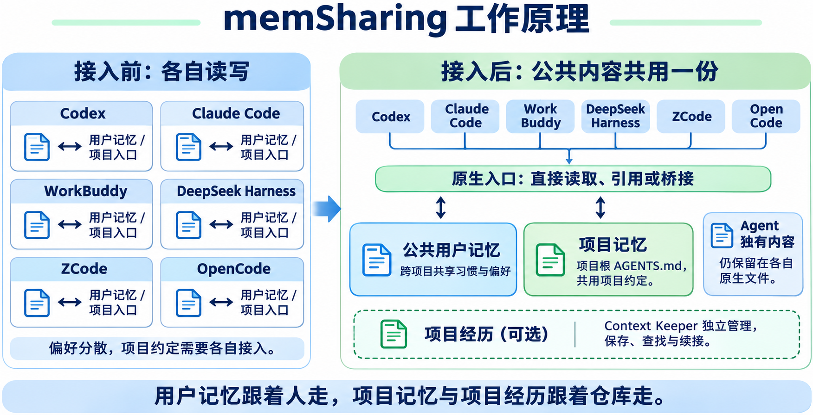

<div align="center">

# memSharing · 多 Agent 记忆共享与融合

**Multi-Agent Memory Sharing & Fusion**

给你的每一个 AI Agent 同一份记忆。

Codex 记住的偏好，Claude 接着用；昨天做到一半的工作，今天任何 Agent 接着做。

[为什么需要](#-为什么需要) · [安装](#-安装) · [工作原理](#-工作原理) · [使用菜单](#-使用菜单) · [记忆中枢](#-用户记忆中枢) · [设计理念](#-设计理念)

</div>

---

<a id="为什么需要"></a>
## 💡 为什么需要？

你同时用几个 AI Agent 时，是不是总在重复交代？

- 🧠 **习惯说一遍，换个工具全白说？** 你让 Codex 记住了“提交信息用中文”，换成 Claude，它一无所知，同样的话从头再说一遍。
- 📋 **昨天做到一半，今天从头交代？** 方案昨天定好了、坑昨天踩完了，今天开个新会话，它完全不记得昨天做到哪里。
- 🧩 **各写一份，越写越散？** Codex 读 `AGENTS.md`，Claude 读 `CLAUDE.md`，WorkBuddy 只认自己的记忆文件——同一个项目，约定散在三处。

memSharing 把「用户记忆 + 项目记忆 + 项目经历（可选）」接到你常用的每个 Agent：习惯说一遍各家生效；项目记忆以项目根 `AGENTS.md` 为唯一来源，各家同读；需要记录项目经历时，由同一作者的 Context Keeper 负责保存、查找与续接。

---

<a id="安装"></a>
## 🚀 安装

把这一句话复制给正在使用的 Agent：

```text
请从 https://github.com/vincent4j/mem-sharing 安装 memSharing（多 Agent 记忆共享与融合）。
```

按 Agent 的提示确认，装好就能使用；随后自动只读对比各 Agent 已有记忆，分“默认共享”与“由你选择是否共享”两块给你选，选定并确认最终修改清单后才会修改文件。项目经历可选安装 Context Keeper。

也可作为 Paseo 插件安装，插件名称为 Memory Sharing & Fusion。

完整安装对话见 [INSTALL.md](INSTALL.md)。

---

<a id="工作原理"></a>
## ⚙️ 工作原理

memSharing 用一份公共用户记忆和项目根 `AGENTS.md`，把六家 Agent 接到同一套记忆上：

- **沿用 Agent 原有的记忆方式。** 仍通过各自的记忆文件读取和维护内容，只把适合共享的部分整理到一起，不另建一套记忆引擎。
- **公共内容共享，独有内容保留。** 各 Agent 共用同一份公共记忆，各自专属的内容仍留在原处。
- **无需额外部署。** 不需要单独配置云端模型、Hook 或常驻服务，继续使用你现有的 Agent。
- **一句话开始安装。** 把安装说明发给 Agent，按提示确认即可，不用自己配置服务和接口。



| 名称 | 解决什么问题 | 放在哪里 |
|---|---|---|
| 用户记忆 | 跨项目的习惯与偏好，例如语言、工作方式 | `~/.mem-sharing/memories/` |
| 项目记忆 | 这个项目怎么干活，各家 Agent 共读同一套约定 | 项目根 `AGENTS.md` |
| 项目经历 | 做过什么、为什么这样决定、接下来做什么 | Context Keeper 管理的项目记录库，默认 `docs/context-keeper/` |

| Agent | 原有用户记忆入口 | 原有项目记忆入口 |
|---|---|---|
| Codex | `~/.codex/AGENTS.md` | 项目根 `AGENTS.md` |
| Claude Code | `~/.claude/CLAUDE.md` | 项目根 `CLAUDE.md` |
| WorkBuddy | `~/.workbuddy/MEMORY.md` | `.workbuddy/memory/MEMORY.md` |
| DeepSeek Harness（`dsh`） | `~/.dsh/AGENTS.md` | 项目根 `AGENTS.md` |
| ZCode | `~/.zcode/AGENTS.md` | 项目根 `AGENTS.md` |
| OpenCode v2 | `~/.config/opencode/AGENTS.md` | 项目根 `AGENTS.md` |

表中为本产品接入的原生入口，不是各家记忆体系的完整清单。接入后，公共用户记忆共用一份，Agent 独有内容仍保留在原生文件；项目记忆以项目根 `AGENTS.md` 为唯一共享来源，各家通过原生读取或引用/桥接接入。

用户记忆跟着人走，项目记忆与项目经历跟着仓库走。用户记忆与项目记忆约定怎么做事，项目经历积累做过的事；Context Keeper 的命令、记录格式与保存、查找流程由它自己定义，memSharing 不接管这些行为。

---

<a id="使用菜单"></a>
## 🧭 使用菜单

装好之后，日常只需要 `/mem-sharing` 一个入口，六项菜单按需选择：

| 菜单 | 什么时候用 | 怎么说 |
|---|---|---|
| 添加新的 Agent | 装了新的 AI 客户端，想让记忆一起生效 | “/mem-sharing，添加新的 Agent，名字叫 WorkBuddy” |
| 批量接入项目记忆 | 一堆项目想一次接入 | “/mem-sharing，批量接入项目记忆，扫描 ~/Tools/Source” |
| 整理用户记忆 | 用户记忆越攒越多，想梳理一遍 | “/mem-sharing，整理用户记忆” |
| 健康检查 | 想确认各项目入口和记忆都正常 | “/mem-sharing，健康检查” |
| 接入项目记忆 | 为当前项目建立记忆入口 | “/mem-sharing，接入项目记忆” |
| 整机卸载 | 归还公共记忆后清理本产品 | “/mem-sharing，整机卸载” |

- **添加新的 Agent**：按本地应用或 CLI 的实际静态证据确认安装，再走同源接入与精确预览；不要求 Agent 应用签名，只有残留配置目录不能视为已安装。重新运行安装器会发现全部已核验 installed 的支持对象。
- **批量接入项目记忆**：递归扫描你指定的目录，逐项目一行预览，一次批准后执行；已停用的项目不会被自动恢复。
- **整理用户记忆**：只读对比各接入 Agent 的用户记忆，共同内容进“默认共享”，部分已有的进“由你选择是否共享”，编号稳定，`查看 3` 可读完整原文；选定后先展示完整修改清单，你确认后才把完整原文迁入公共记忆并精确删除各文件中的重复片段，本次融合在最终确认前不会修改记忆内容。
- **健康检查**：只读报告登记与现场缺口，不修复、不写入。
- **接入项目记忆**：进入未登记的 Git 主 checkout 默认按当前执行者接入；接入完成后自动进入当前项目记忆的只读融合预览（两块，本次融合尚未修改记忆内容），可按编号选择、查看或保留现状；历史停用登记跳过、不自动重建，不控制 CK。
- **整机卸载**：先外置备份与独立恢复材料，把当前完整公共记忆归还每个实际接入的 Agent，再核验并清理机器资产；预览并批准后才执行。在任何一家已接入的 Agent 里直接说“卸载 memSharing”也进入同一路由；“卸载这个项目”会先澄清，不删除当前项目。Paseo 插件本体需独立移除（disabled 不算），默认保留 Context Keeper；完整合同见[整机卸载方案](docs/uninstall-design.md)。

安装时会识别并接入你已安装的受支持 Agent；以后换工具，也可以随时添加。

**想要项目经历？** 在需要的项目里使用 `/context-keeper`：首次按 Context Keeper 的流程初始化记录库，记录库建在项目里、随 Git 走，各家 Agent 共用（安装时会问一句要不要装它：回车＝同意，输入 n 跳过）。用户级安装目前覆盖 Codex、Claude Code 与 WorkBuddy；DeepSeek Harness、ZCode 与 OpenCode 暂不在其安装范围，不影响它们共享记忆。没装它，用户记忆与项目记忆照常工作。

命令参数、停用与恢复的精确语义见 [SKILL.md](SKILL.md) 与 [INSTALL.md](INSTALL.md)。

---

<a id="你可能想知道"></a>
## ✅ 你可能想知道

| 问题 | 说明 |
|---|---|
| **会多花 Token 吗？** | 用户记忆先读简短索引，需要时才读主题概要与全文，不全量注入所有内容。 |
| **需要自己维护吗？** | Agent 按规则使用和整理记忆；整理先给完整逐条计划，一次确认后执行。独有或归属不明的内容保留。 |
| **会动我的文件吗？** | 写入有明确范围；发现冲突或受管内容漂移即停止，不覆盖你的改动。Agent 独有内容永不并入公共源、永不删除。 |
| **怎么检索记忆？** | 检索只用索引精确查找（find），不使用 search 或语义搜索。 |
| **如何添加新 Agent？** | 打开 `/mem-sharing` 选择“添加新的 Agent”可限定接入；重新运行安装器会按 installed 自动发现并精确预览全部支持对象。 |
| **怎样卸载？** | 在任何一家已接入的 Agent 里直接说“卸载 memSharing”，预览并批准后执行。完整卸载后，各 Agent 恢复原有的记忆使用方式；公共记忆完整归还到各自的原生文件，原有独有内容保留，记忆不会丢失。 |
| **不装 Context Keeper 可以吗？** | 可以。用户记忆、项目记忆照常共享，只没有项目经历的保存与续接能力。 |

---

<a id="用户记忆中枢"></a>
## 🗂 用户记忆中枢

安装时在家目录创建，你的习惯都放在这里：

```text
~/.mem-sharing/
├── memories/
│   ├── MEMORY.md             # 索引：读取契约、真实主题一览
│   └── <主题>.md             # 开头概要，后接细节
├── references/               # 按需读取的操作手册
├── backups/                  # 可核验的操作恢复材料
└── var/                      # 本机台账与锁
```

`MEMORY.md` 只保留读取、保存归属、主题索引、自动项目接入与持久 Skill 入口；六项菜单和详细流程只在 `SKILL.md`，新装不生成《使用约定》。公共内容写公共文件，Agent 独有内容留在各自的用户文件；Claude 的项目兜底规则在它自己的用户文件，不放公共索引。中枢不创建 `skills/`、`mcp/`，不管理共享 Skills/MCP。

---

<a id="设计理念"></a>
## 🧭 设计理念

- **一份记忆，一个来源。** 用户记忆集中保存，项目记忆以 `AGENTS.md` 为准。
- **按需读取。** 索引恒读，主题概要按需读，仍不足才读全文。
- **独有内容保留。** 公共与专属内容各有归属，未知归属不擅自判断。
- **漂移即停。** 不用覆盖用户改动来制造成功。
- **安装与验证分开。** 静态入口完成不等于已经证明所有执行器的新会话行为。

### 了解更多

完整设计：[DESIGN.md](DESIGN.md) · 安装操作：[INSTALL.md](INSTALL.md) · 会话操作：[SKILL.md](SKILL.md) · 文档地图：[llms.txt](llms.txt) · [验收总览（源码仓库）](https://github.com/vincent4j/mem-sharing/blob/main/docs/acceptance/index.md)

完整职责边界、数据归还、自然语言触发与独立恢复见[整机卸载方案](docs/uninstall-design.md)。正式 payload 与真实宿主验收仍按发行/验收门槛执行。
