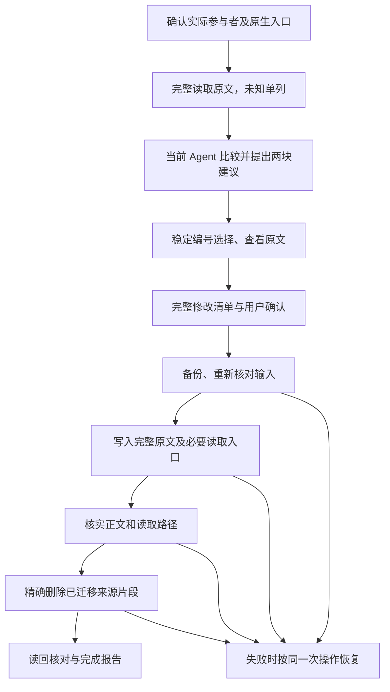

# memSharing 当前模块盘点与简化方案去向评审

- 日期：2026-11-03。
- 状态：**用户已审核同意并于 2026-11-03 明确要求开始实现。以下保留评审时的现状与建议；此次授权恢复源码实现，不自动授权提交、发行或真实数据删除。**
- 编写：巴克队长，依据本工作区源码进行只读盘点，由我承担取舍责任。
- 盘点基线：`refactor/skill-first-memory-sharing`，HEAD `50001cf259be8ea6a7c29201dfa0e5a82d67758b`；另包含本次未提交的 `scripts/agm_core/memory_share.py` 初稿。
- 权威依据：[已通过的过度设计复盘](2026-11-03-memory-sharing-overengineering.md)、[记忆共享与融合 PRD](../memory-sharing-fusion-prd.md)。[此前切片建议](simplified-skill-implementation.md)只作背景，不强制采用它的接口。

## 1. 先停下来：当前到底做到哪里

用户已明确停止实现。本轮不修初稿、不增加测试、不启动第二段、不生成安装物，也不改真实 HOME、原生记忆、外置备份或旧工作区。执行者已结束；继续实现指令已撤销，首段自动审核提醒已取消。

当前新空间的产品差异只有未跟踪的 `memory_share.py`。主负责人另改了 CK 索引并新增当前工作日志。没有改 `agm.py` 路由或根 `SKILL.md`，因此初稿里的三个新命令**尚未接入现有主 CLI**。

执行者报告 `py_compile` 通过，但明确有六处未修错误，没有运行完整链路。本轮只读核查发现初稿实际为 **1000 行**，并非回报的“约 700 行”；行数本身不是否定理由，功能和职责是否收敛才是。本轮没有运行该初稿或重跑产品测试。

真实产品最近状态仅沿用交接：R4995 已安装且已融合，重复同名章节归还仍受阻；六家原生新会话与整体验收未通过。本轮未重新读取私人正文或核验安装现场，不能将交接状态写成当前实测。

计时分别保留：旧验收累计 17:17:31 为交接历史；新重做累计起点 12:13:48 UTC，突突兔实际执行 12:15:08–12:25:43 UTC，约 10 分 35 秒。它在截止前主动停报，**没有触发满 15 分钟审核，也没有获准第二段**。用户随后要求停止实现，下面的盘点是新指示下的文档工作，不是续期实施。

## 2. 我的结论

新方案应该保留“Agent 理解、用户决定、小工具准确修改”的主线。该删除的是不必要的职责和耦合，不能把承载旧用户恢复能力的文件与数据一起删掉。

具体建议是：

1. **保留并收缩核心：** 原生文件位置与读取方式、公共目录与正文、两块选择与完整确认、精确文件修改、备份与恢复、明确来源关系、当前项目记忆接入。
2. **修改主流程：** 从安装/台账/发行状态中解耦；内容判断由当前 Agent 完成；文件工具不再以标题解析结果决定记忆身份和归还位置。
3. **从核心移出但不取消产品能力：** 安装、升级、Paseo UI、运行时依赖下载、批量项目接入。这些有用户需求背景，应作为独立外围能力，不是每次共享的前置条件。
4. **冻结为旧版兼容：** 历史导入、台账迁移、旧入口转换、staging 退役、旧版卸载与外置恢复。在旧现场关闭前保留，不继续往新主线堆叠。
5. **否决当前新初稿直接接线：** 它没有证明复盘要求，且存在原文关系不完整、统一引用方式、修改后归还不足等结构问题。建议审核后撤下这份初稿的产品路线，提取有依据的基本操作思路，不以“修掉六处 bug”作为继续理由。现在仅保留现场，不执行撤除。

这里“保留功能”不等于保留整个文件；“删除职责”不等于立刻删除源码；“退出核心”也不等于取消用户要求的能力。

## 3. 新方案的功能边界

### 3.1 用户记忆的完整主线

共享目录可以在用户授权的建立步骤创建；内容预览和编号选择本身不写记忆。不能为“零写预览”禁止正常建目录，也不能以建目录授权代替迁移正文的最终确认。

最少需要保存的事实：来源文件及读取依据、每处被移走的完整原文与位置、它与公共内容的对应关系、修改前后依据、该次操作的备份及结果。保存这些事实是为保全与归还服务；它们不应膨胀为第二份产品安装台账。具体承载在现有操作材料的哪里，须先用多轮操作实例证明，再确定接口和目录。

### 3.2 必须保留的产品合同

| 功能 | 新方案决定 | 原因与边界 |
| --- | --- | --- |
| 全参与者且 N≥2 同内容 | 默认推荐，仍需最终确认 | 防止单家内容被当作公共共识。 |
| 至少两家、未覆盖全部 | 待选，默认不迁移 | 来源覆盖不是语义推断。 |
| 单家、未知、受保护内容 | 单家留原处；未知明确报告；专属与 CK 原处保护 | 不把读失败当空，也不把重复协议当公共偏好。 |
| 两块、一句话摘要、稳定编号、空块暂无、查看原文 | 保留，由 Skill 对话组织 | 程序首行不等于摘要；查看不等于选择或批准。 |
| 完整原文、精确来源、最终完整清单 | 保留 | 摘要不能替代正文，批准必须落到实际文件变化。 |
| 先写后删、漂移检查、失败恢复 | 保留小工具实现 | 这是用户数据保护，不是外围平台建设。 |
| 第二次正常共享 | 核心必验 | 不能用“已存在记录，因此拒绝”代替连续使用能力。 |
| 共享后新增/修改、再归还 | 核心必验 | 当前公共内容不能丢，旧备份不能覆盖用户的新偏好。 |
| 原生读取验证 | 分为入口静态检查和真实新会话验证 | 文本中存在指针不证明 Agent 已读取。 |
| 项目记忆 | 保留，用户主线通过后复用基本操作 | 仅当前项目，以独立文件计数；根 AGENTS 是已有公共基座。 |
| 项目经历 | 保留 CK 边界，memSharing 不实现经历引擎 | 不接管记录格式、历史检索、自动保存和 CK 授权。 |

### 3.3 三个去向层次

- **新核心：** Skill 对话、薄 CLI、六家原生适配、精确变更与同一次操作恢复、当前项目规则。
- **可选外围：** 安装分发、Paseo 展示、依赖准备、版本升级、批量接入。外围调用核心，核心不反向依赖外围才能读写用户记忆。
- **旧版兼容：** 现有安装台账、旧迁移、旧卸载修复、外置恢复。只在识别到旧现场且需要相应动作时使用；新流程遇旧现场不能盲写，也不能默默绕过未完成恢复。

不建议此时新建三个包或三个服务。上述是职责与调用边界，不是新的框架建设清单。

## 4. 当前核心与项目模块逐项盘点

下表路径均相对仓库根；名称可在“源码证据入口”找到。决定为建议，尚未实施。

| 模块／文件 | 当前实际功能 | 决定 | 新方案去向与理由 |
| --- | --- | --- | --- |
| `SKILL.md` | 六项操作菜单，转安装、项目接入、整理、检查和卸载；根文档自称仓库操作说明，实际菜单位于公共指南 | **修改，保留入口职责** | 成为真正的四步对话编排入口，详细管理命令按需读。消除“Skill→公共指南→安装手册→台账”才能开始共享的长链；不自行扩增全局安装范围。 |
| `scripts/agm.py` | 解析项目命令、统一 JSON/退出码、前置分派融合及卸载等命令 | **修改，保留薄路由** | 路由、参数与明确错误继续保留；新共享入口不强制先完成整机产品安装。旧命令保留兼容出口，不再形成一套新壳并长期双维护。 |
| `scripts/agents.json` | 六家 macOS 用户/项目路径、rule_mode、安装信号、Skill 路径和运行状态占位 | **修改，保留适配事实** | 原生路径与读取方式必须保留；把安装探测和真实运行验收与路径分开理解。仅配置 darwin，不把 Windows/Linux 写成已支持。 |
| `paths.py` | 校验路径表、平台和参与者，展开用户/项目路径，生成允许路径 | **保留并收缩** | 作为新核心的原生文件寻址；不把安装信号、所有权账本等一起强制带入内容操作。不得让任意输入路径扩大删除范围。 |
| `layout.py` | 定义公共根、活动代码、registry、锁、备份位置；路径检查不创建目录 | **修改，复用基本路径检查** | 共享根、备份、现有锁仍可复用；纯共享不应要求活动代码或 registry 存在。保留对实际写集的路径/链接检查，不把历史路径异常无限扩大为全局阻断。 |
| `detect.py` | 本地 CLI/App/收据安装证据，installed/absent/unknown；不验证模型登录或读取效果 | **修改并退出核心硬门槛** | 供发现与安装报告使用；参与者以实际使用和原生入口证据核实。显式名字或空目录不能自行证明参与，实际会话证据也不应被无关应用签名挡住。当前代码已取消签名硬门槛，不再“修复”已去掉的问题。 |
| `entries.py` | 精确受管块、引用行、生命周期片段、链接与字节指纹操作 | **保留基本原语，限制用途** | 用于已知范围的入口变更；不用于猜自由正文属于谁。保留字节，避免全文件重排。 |
| `transaction.py` | 快照、文件原子替换、协作锁、manifest/备份、失败回滚与显式恢复 | **保留，优先复用** | 这是必要保护，禁止另造同类恢复系统。现实现是逐文件原子替换，不是跨文件原子提交；不能声称阻止所有外部编辑器竞态。按顺序验证公共内容再删源。 |
| `user_rules_organize.py` | 用户/项目融合预览、段落分组、编号选择、计划执行、读者核验；依赖 installed registry、探测和旧入口归属 | **重构，保留产品行为** | Agent 接管语义比较与摘要；小工具只验证明确的原文与写集。删除新主线对产品发行/台账的前置依赖，停止以通用标题/段落分类作为内容身份权威。已有项目去重、选择和三阶段写入证据可参考，不整包照搬。 |
| `fusion_recovery.py` | 为现有融合 Transaction 回滚提供精确批准 CLI 包装 | **保留恢复能力，修改耦合** | 继续复用 Transaction，旧操作可继续恢复；新操作尽量复用薄包装，不为新命令重复写一套恢复引擎。 |
| `user_entries.py` | 建公共索引/使用约定模板；按安装证据装配用户指针和各家兜底；维护台账、顶置入口 | **拆职责后修改** | 原生入口适配留核心，长菜单/安装编排移外围；保护已有私文与 CK。不要为了共享一个偏好自动重写公共治理文档和六家入口。 |
| `user_entry_layout.py` | 将已登记、精确归属的用户入口移到逻辑顶部，其他字节视作不透明 | **保留必要的精确编辑；旧版检查隔离** | 布局是读取兼容问题，不是语义融合。没有已确认需要时不自动搬动私文；require_kernel/source 等旧产品条件不应成为新内容迁移前置。 |
| `entry_layout.py` | `migrate-user-entry-layout` 外壳，转现有用户入口装配，绑定批准 | **旧版兼容保留，未来可退役** | 它是既有入口修迁工具，不是每次新共享的步骤。待旧入口全部迁完且无调用后再删除命令和实现。 |
| `project.py` | 解析 Git 主 checkout/common-dir 身份，拒 linked worktree | **保留项目边界能力** | 只用于项目操作；用户记忆不依赖 Git。当前 worktree 默认不接入规则的治理边界不因简化擅自撤销。 |
| `enable.py` | 建项目 AGENTS 基座、Claude/WorkBuddy 入口及 CK 短协议，核安装/台账并登记 | **修改，保留项目接入** | 当前实际使用者接入当前项目；保护已存在正文、disabled 历史登记和 CK 独立性。移除不必要机器安装耦合，不能顺带给未使用 Agent 建文件。 |
| `batch_enable.py` | 只读扫描项目，集中批准后顺序调用 enable；已登记与 disabled 跳过 | **保留为可选外围，后置** | 用户有批量需求，但它不解决四步共享主线。复用单项目结果，不再把扫描器作为核心能力前置。 |
| `check.py` | 项目入口、台账、所有权和漂移只读检查，不查 CK 记录库 | **修改，拆清检查对象** | 新核心检查“原文、入口、写集、读取证据”；旧台账健康检查独立保留。状态正常不能冒充原生新会话通过。 |
| `registry.py` | schema 1/2/3 校验、项目及机器受管对象、产品身份、所有权、历史证据、最终登记提交 | **退出新核心，旧版兼容保留** | 新内容迁移不需要整份安装账本。旧版卸载/恢复确实依赖它，不能现在删文件或丢账；最小来源关系也不能重新长成它的复制品。 |
| `__init__.py` | Python 包入口 | **保留** | 没有独立产品复杂度，不为“减少模块数”删除必要包结构。 |

## 5. 安装、版本、兼容和卸载模块逐项盘点

| 模块／文件 | 当前实际功能 | 决定 | 新方案去向与理由／退役条件 |
| --- | --- | --- | --- |
| `scripts/install.py` | 获取固定源、安装/同版接入、升级、恢复及独立 CK 安装的 CLI 编排 | **修改，留外围** | 保留方便安装的能力，但安装来源状态不应控制每次语义比较；新 Skill 的分发/原生发现应简单清晰。现有安装方式不能未经验证直接替换。 |
| `user_install.py` | 分类新装/旧现场；构造安装计划，固定工具包，装配代码/入口/台账并恢复 | **旧版保留；新安装简化后替换相应路径** | 新用户不必为共享承担整机生命周期全套成本；已有产品需要它解释安装现场，不能破坏恢复。 |
| `versions.py` | 完整发行库存，验证槽位，激活证明 | **可选发行层保留** | 版本库存属于产品维护，不属于用户记忆内容。新核心不查询库存才能工作，仍不应把代码和私人内容混放。 |
| `upgrade.py` | 六阶段升级、转换、活动标记、固定版本恢复，台账最后提交 | **外围/旧版保留，停止扩入主线** | 旧安装升级确有恢复责任；四步内容共享不应启动或继承版本切换状态机。将来是否彻底移除取决于新分发方式及存量退役。 |
| `plugin_release.py` | 固定源码、确定性 payload、发行清单、持久源码导出及验证 | **发行层保留** | 分发完整性有价值；只有发包时使用，不能为了共享或测试先生成 S/R。 |
| `legacy_import.py` | 只读盘点 v0 `~/.agents-group`，生成原文字节复制计划，不执行旧脚本 | **旧版兼容保留，最终退役** | 不再让新用户经过 v0 分支；旧数据导入仍需原文保全。所有目标存量已处理且有恢复出口后才删。 |
| `migrate.py` | 旧台账诊断与迁移证据，同时承载被多模块复用的 I/O 辅助 | **旧版冻结；通用原语按需复用** | 不能按文件名认定可整文件删除，安装/升级等仍导入它。退役前查调用，避免删除兼容文件时带走必需 I/O。 |
| `public_layout.py` | 将 0.1.1/0.1.2 公共正文与入口转换为分层索引/指南，带 journal、guard、恢复 | **旧版兼容冻结，最终退役** | 新目录直接建立简洁布局，不运行历史转换；真实旧现场仍可能依赖其备份证据，不能直接清理。 |
| `legacy_reconcile.py` | 针对旧 Claude import 的证据绑定核对/修复 | **旧版兼容冻结，最终退役** | 解决特定旧归属问题，不泛化成新入口发现器；无剩余现场与调用后撤除。 |
| `policy_migration.py` | 退役旧 memSharing 对项目经历的控制，保留 disabled 语义；供卸载复用 | **保留隔离能力，兼容后退役** | 新方案从一开始就不接管 CK。旧控制仍须有显式退出办法，不能删除模块后把旧控制遗留在用户文件。 |
| `uninstall_memory.py` | 识别公共正文/产品包装，结合历史融合证据做归还，包含按 scope 合并原生正文 | **归还功能保留，核心算法重做；旧算法隔离** | 当前源码存在重复 scope 歧义分支，与交接阻断一致。新流程不能再靠标题推断原位置；保留产品包装证据，但不按关键词删用户文。 |
| `uninstall.py` | 整机卸载预览、归还、产品资产与备份盘点、CK 保全、外置恢复及宿主证据 | **拆职责，旧版保留** | “归还记忆”和“删除程序/插件”分开。前者属于核心退出能力，后者是外围卸载；归还无损未证实前不能拆毁旧环境。 |
| `uninstall_recovery.py` | 无 agm_core 依赖的外置恢复、manifest 校验/应用、解释器校验及宿主/CK 后续 | **保留独立恢复；新核心不整包引用** | 产品目录删除后仍须恢复，独立存在有正当理由。其宿主和 CK 编排不应进入每次记忆共享。 |
| `uninstall_compat.py` + `scripts/uninstall_compat.py` | 从固定独立源码处理旧卸载兼容，不替换已安装 C；验证历史备份、DSH 引用 | **旧版救援工具冻结，最终退役** | 为已存在现场保留可用工具，不继续泛化。源码保留不构成执行真机卸载授权。 |
| `uninstall_fusion_repair.py` + `scripts/plan_fusion_return_repair.py` | 用外部卸载 manifest 与固定 Git 对象构造特定归还纠正的离线计划 | **移出正常产品路径，历史救援保留** | 一次事故的证据工具不应成为新用户主流程。现有证据可追溯，不能为了简化抹掉失败与修复材料。 |
| `staging_retirement.py` + `scripts/retire_staging.py` | 固定独立工具核验并退役窄格式 Paseo staging，检查宿主凭据与历史闭合 | **旧版/外围冻结，最终退役** | 退役残留是安装维护问题。未知旧备份不能为了让新流程通过而删除或“认领”。 |
| `ck_install.py` | 单独批准后调用固定 CK 上游安装器，明确支持与跳过的 Agent | **可选集成保留并简化边界** | 用户可需要安装便利性，但 memSharing 不安装/启用项目经历库、不实现其引擎。新主线无需依赖 CK 安装成功；不改上游。 |

## 6. Paseo 插件、共享依赖与发行工具盘点

这部分不是“全部删除”。复盘承认插件与安装便利性有真实需求，错误是把它们变成核心交付前置。

| 模块／文件组 | 当前功能 | 决定与新去向 | 理由 |
| --- | --- | --- | --- |
| `plugins/paseo/index.server.ts` | 注册预览/确认/恢复等 RPC，绑定宿主配置中的插件来源 | **保留为外围薄适配，随核心接口修改** | UI 与 CLI 应调用同一套能力，不复制另一套业务与批准逻辑。 |
| `server/orchestrator.ts` | Python/Git 依赖、安装、接入、融合、卸载、staging、CK、恢复流程；pending token/超时/确认暂存 | **修改并收缩，保留外围职责** | 当前同一个编排器串了十类流程。按能力隔离即可，不要求马上拆十个类；核心内容操作不应被 payload/安装启动门禁绑住。 |
| `server/payload.ts`、`server/shared/release-identity.ts` | 定位并绑定正式 payload 和摘要；开发态空 identity | **发行/宿主层保留** | 保证使用正确安装包，但不让开发核心测试必须伪造正式发行身份。当前新空间不是正式发行。 |
| `server/owned-paths.ts` | 宿主创建目录时核验真实路径 | **保留原语** | 精确路径保护成本小、用途明确。 |
| `server/ck-source.ts` | CK 固定源获取计划及执行 | **可选 CK 便利入口保留** | 不纳入共享必需链，不将获取成功冒充 CK 安装或使用成功。 |
| `shared/contracts.ts` | RPC 请求响应的类型与校验合同 | **保留，随业务收缩更新** | 宿主边界需要输入校验；不用它另定义一份记忆内容真源。 |
| `index.client.tsx`、`client/flow.tsx`、`client/status.tsx` | 菜单、流程页、状态展示与用户确认 | **保留 UI，后置对齐** | 核心闭环后再接；安装状态、静态入口、真实读取分开展示。 |
| `client/fusion.ts` | 融合组与结果提取 | **修改、复用核心输出** | 两块与稳定编号使用同一组数据；不自行以首行替代 Agent 摘要。 |
| `client/uninstall-result.ts` | 卸载结果解析和后续状态 | **保留外围，区分归还/删除/CK** | 避免某一步成功就声称完整卸载。 |
| `plugins/shared/src/process.ts`、`json.ts`、`digest.ts`、`paths.ts`、`index.ts` | 子进程、退出/输出约束、JSON 校验、摘要和插件路径公共原语及导出 | **保留必要库** | 避免各插件重复实现；不是共享语义引擎，不随 Python 核心简化乱删。 |
| `plugins/shared/src/python.ts`、`git.ts` | 查找并验证可用 Python/Git | **可选环境准备层保留** | 插件使用工具需要环境；读取记忆不应要求无关 Git 安装成功。 |
| `plugins/shared/src/supply.ts`、`download.ts`、`tar.ts`、`tool-assets.ts`、`production-assets.ts` | 依赖供应清单、下载/校验/安全解包、私有工具安装与生产资产表 | **外围保留，暂停扩展** | 解决无依赖机器的安装便利性，不解决核心迁移；不因路线简化取消已有供应安全检查。 |
| `plugins/shared/sync-to-plugins.mjs`、`server/shared/common/` | 公共 TS 真源生成宿主副本，转换导入后缀并同步许可证 | **保留当前构建方式；副本不手改** | 这些是生成副本，不是可随手删除的业务重复；将来改变打包方式再一并调整。 |
| `tools/plugin-release/release.py`、`check.py` | S→R 生成、源码/发行校验 | **发行时使用，移出日常迭代验收链** | 不再每修一个相邻缺陷就生成安装物；没有发行授权不运行生成。 |
| `paseo-plugin.json`、两个 `package.json`、`tsconfig.json` | 插件身份、依赖、脚本和类型配置 | **保留，按接口变更修改** | 属于现有插件运行基础，不是过度设计本身。 |
| `assets/`、`notices/`、`THIRD_PARTY_NOTICES.md` | 图示、图标与第三方许可 | **保留，必要时只改过时图示** | 简化不能删许可；资产不能被当作用户数据清理。 |

## 7. 新初稿 memory_share.py 的单独裁定

**建议：不批准直接接线，不批准以修六处 bug 后继续作为默认方案。当前文件保留供审核；审核后决定撤下或仅提取已证明的原语。**

它做对的方向：尝试让 Agent 提供摘要和分组；采用精确字节范围；复用现有 Transaction；不依赖 registry 才能读正文。这些可以保留为设计原则，但目前不足以保留整份实现。

| 功能／设计 | 代码中的现状 | 建议去向及理由 |
| --- | --- | --- |
| 提案 JSON 与来源绑定 | `basis`、`groups`、字节范围和 hash；只接受分段器预切出的完整片段 | **保留输入绑定需求，重新压缩接口。** Agent 需要明确来源，但不应为绕过旧分类再建通用文档解析协议；先验证真实原文边界，不能由程序分段先限制 Agent 判断。 |
| 格式归一与 scope 判同 | 用正文归一、标题数组及 Agent 的 same_content 决定默认组 | **降为校验线索。** 两个同名章节的标题数组可相同，但上下文并不等同；不能把标题相同当作用域相同的充分证明。 |
| 同内容组只写一个成员 | `written = members[:1]`；`provenance.fragments` 也只记录写入成员；所有成员却都列入来源删除 | **必须否定此来源关系设计。** 多家迁出来源没有逐一保存到归还关系中；格式略异的完整原文也未逐份进入公共正文。应完整保留每份原文，并记录每处来源及重复次数，展示是否合并不决定删掉哪些原文证据。 |
| 各家统一 @ 引用 | `_entry_line` 与 `_verify_entries` 要求每家恰好一行 `@公共索引` | **删除统一假设，复用每家原生适配。** 当前路径表明确区分 native/import_agents/user_convention；Claude 引用不能未经验证当作 Codex 等的通用读取机制。此函数只是计数，不是读取验证。 |
| 四步中建立入口 | 执行前要求入口已经存在，本身不装配相应入口 | **补全职责后再实现。** 初次使用不能先被未创建的读取入口卡住；入口变更须列入同一完整清单并按家核验。 |
| `share-records/<txid>.json` | 新持久目录，事务内写入，并另行扫描作为归还依据 | **暂不批准新目录设计。** 保存来源关系有必要，但应先评估现有 manifest/备份能否承载；不能默认加一份长期索引。这里没有新事务引擎，但已增加独立持久数据合同。 |
| 公共内容修改后归还 | 以旧 `public_bytes` 定位；若 absent_or_modified，函数仍报“请人工处理”，没有消费修改后正文的有效路径 | **重做实际使用路径。** 回报“以当前公共文本为准”并不等于代码实现。应读取当前内容，展示差异，必要时由 Agent 提出明确关联及目标、用户确认；不能永久停在拒绝。 |
| 原生漂移后一律追加 | 指纹不同则文末追加；相同则按历史 start 插入 | **删除默认追加策略。** 可能重复、改变作用域或位置；多轮删除后的旧偏移也不能直接用。需要用明确来源及当前差异生成归还计划，不按一个指纹布尔值代替位置关系。 |
| 公共新增 | 未匹配新增内容保留公共，但没有完整归还目标处理链 | **保留“不丢”原则，补足退出能力设计。** 部分归还可以保留公共；完整退出不能留下仍依赖将被删除目录的内容或入口。 |
| 归还保留 @ 指针 | 将其归为安装面，归还本身不动 | **仅对“部分归还”可成立。** 若宣称完整归还退出，必须列明指针去向，不能留下无效读取。归还与卸载应分开定义。 |
| 六处已知代码错误 | 缺 selection_input、来源路径映射反写、CK 变体配对、layout 配置、插入顺序、record 类型混用 | **冻结，不在本轮修。** 这些证明初稿尚不可执行；修掉也不会解决上列结构问题。 |
| CLI 与 Skill 集成 | 文件有 cli 定义；主路由和根 Skill 均未改 | **未接线，不算可用功能。** 暂停期间不接入，不能用模块存在宣称四步已完成。 |

这也说明我的上一轮派工仍然过早：我要求“先做完整链”，却没有先审清哪些旧职责留下、哪些退出，以及归还的最小关系设计。让执行者同时补主流程、归还和恢复，仍可能把简化变成新的一千行实现。我应先完成本次去向评审，再决定实现边界。

## 8. 文档、测试与数据的去向

### 8.1 文档和测试

| 对象 | 决定 | 理由 |
| --- | --- | --- |
| 复盘、融合 PRD | **保留为约束依据** | 不因初稿实现方便而降低原文、二次使用、归还标准。 |
| `DESIGN.md`、`docs/architecture.md` | **审核后更新当前架构，保留历史定位** | 当前仍以 R/C/V 和安装台账为中心；架构文档还列出源码中不存在的 `remove.py`，不能据文档标题断言有该模块。 |
| `README.md`、`INSTALL.md`、`docs/operations.md`、`SKILL.md`、`llms.txt` | **审核后统一用户路径** | 清楚区别共享、接入、归还、卸载和恢复；不要互相循环回指。 |
| 插件 README/OVERVIEW、发行工具 README | **保留外围文档，随后对齐** | 不用核心简化之名取消安装便利需求，不宣称源码态就是发行态。 |
| `docs/uninstall-design.md` | **保留历史合同，补新旧边界** | 旧用户退出仍需证据；新归还算法不能覆盖历史说明造成恢复歧义。 |
| `docs/acceptance/` | **保留历史证据，标明适用基线** | 过去测试通过不自动证明新实现；旧未通过项不被新文档抹掉。 |
| `tests/unit/`、`tests/integration/` | **保留现有保护用例，审核后按功能改造** | 核心完整链优先；旧台账/升级测试放兼容范围，不为了降低失败数直接删掉。 |
| `plugins/paseo/test/`、`plugins/shared/test/` | **保留，对应外围变更再运行** | 本次只写盘点文档不重跑；未来改核心不必机械重复所有下载/解包测试。 |
| `docs/context-keeper/` | **保留，日志只追加** | 项目经历归 CK。不得将记忆重写成“之前一直正确”；不因本轮换空间重复压缩询问。 |
| `AGENTS.md` | **保持治理边界** | 当前任务历史不写进规则。用户记忆、项目记忆和项目经历职责保持。 |

### 8.2 真实数据与安装资产

| 位置／对象 | 当前用途 | 建议去向 |
| --- | --- | --- |
| `~/.mem-sharing/memories/` | 用户公共原文、索引与指南 | **保留为公共内容根。** 不是缓存，不随代码升级或卸载顺手删除；归还后如何处理需完整清单。 |
| `~/.mem-sharing/references/` | 公共参考资料 | **保留。** 未纳入本次迁移的内容不能被默默遗漏。 |
| 各家原生用户文件、当前项目规则 | 用户原文、专属内容、CK 协议及读取入口 | **保留并精确修改。** 来源删除只限已批准且公共完整验证的片段，不能整文件覆盖。 |
| `~/.mem-sharing/backups/` | 操作快照和恢复证据 | **保留。** 不是为了缩小复杂度可以清的历史垃圾。 |
| `var/registry.json` 与相关锁/活动 journal | 旧版安装、受管对象与操作状态 | **存量保留，不为新核心复制。** 未完成事务先走对应恢复；新流程不得抢锁或绕过。 |
| `~/.local/share/mem-sharing` 与版本库存 | 已安装代码和发行版本 | **暂时保留。** 未来部署/退役有独立计划，本轮不更新。 |
| `.mem-sharing-install-*`、Paseo staging 与外置备份 | 安装/卸载过程及恢复材料 | **不变。** 依归属、完整性、恢复闭合判断，不能凭目录名删除。 |
| 初稿提出的 `share-records/` | 拟新增来源关系数据 | **尚未批准实际布局。** 只审设计，没有在真实 HOME 创建。 |
| Context Keeper 源码、Skill、记录库 | 独立经历工具与数据 | **不动上游与用户数据。** memSharing 只保护协议和必要可选入口。 |

## 9. 按什么顺序改变，什么条件下才能删除

建议用户审核通过方向后，再单独进入实施；本文件不自动触发。

1. **先定职责与一个最小关系样例。** 用两份短原文明确“每处来源→完整公共内容→第二次操作→用户编辑→归还”的期望字节、位置、次数。先解数据关系，不先造 JSON 协议或持久目录。
2. **复用原语实现一条链。** 优先保留 Transaction、路径、安全字节编辑；Agent 完成内容理解。初稿不因已写一千行而优先采用。
3. **通过正常与失败实例。** 首轮、第二轮、重复标题/原有重复/不同作用域、未选/独有/CK、公共新增/修改、源漂移、写入失败恢复。正常二次使用必须成功；真实歧义提供具体差异与可确认去向。
4. **再扩六家与项目。** 每家独立原生读取方式，不统一假设；项目按独立文件去重、已有 AGENTS 公共内容默认保留。每层分别报告合成与原生新会话证据。
5. **最后接可选外围。** 插件 UI 复用核心，安装分发按既有授权另做；不为每个局部修补生成发行包。
6. **旧路径最后退役。** 先确认旧现场迁移/退出/恢复完成、调用者已迁走、恢复工具可用，再审具体源码删除 diff。保留必要历史证据，不要求旧用户为新核心先做破坏性清理。

建议删除/退役的对象与条件：

| 对象 | 删除的是哪一层 | 前提 |
| --- | --- | --- |
| 共享依赖 installed registry / S/R / 活动代码身份的前置条件 | 新核心调用路径 | 对实际参与者、原文和写集有直接验证；旧现场恢复状态仍被尊重。 |
| 以标题、首行、段落形状决定语义或归还位置 | 核心决策职责 | Agent 明确原文关联与用户确认；精确执行与回归覆盖成立。 |
| 新初稿的统一 @、缺多来源关系、漂移默认追加等设计 | 新实现候选 | 用户批准去向评审后，以已证明样例替代；本轮不删除文件。 |
| 旧历史迁移、一次事故修复和 staging 工具 | 最终源码/命令 | 不再有依赖现场或调用，旧恢复出口保全；不得仅因“看起来旧”删除。 |
| 重复菜单与过时文档说法 | 产品文本 | 新入口可发现、操作路径完整，历史文档保留适用版本说明。 |
| 真实用户内容、备份、CK 数据 | **不在本次删除候选中** | 任何后续真实退役均需精确计划和对应授权，不因架构审核获得删除权。 |

## 10. 待审核的决定与尚未解决的问题

希望你审核的是以下决定，而不是批准某个代码文件名或新框架：

1. 四步主线作为核心，安装/版本/Paseo/批量能力独立为外围，保留功能但不挡住核心使用。
2. 保留现有精确文件操作和恢复原语；旧 registry 与历史迁移退出新主线，但旧现场关闭前不删。
3. 原文语义由 Agent 判断，归还不再以标题猜位置；必须逐处保留来源关系与完整原文。
4. 当前 `memory_share.py` 不直接接线、不按“修六处 bug”继续，先完成关系样例与职责裁定。
5. 项目经历继续完全交 CK；项目记忆功能保留，排在用户记忆完整链之后。

尚未解决且不能写成已实现的事项：多轮共享后原生/公共双方编辑时的精确归还方案；最小来源关系如何复用现有操作材料；旧安装向新主线的兼容入口；六家实际新会话读取验证。这些应由下一轮有限设计与实例证明解决，不要求用户选择内部 JSON 字段，更不能用“全部拒绝”绕过。

## 11. 本轮证据与验证边界

盘点做了：核分支/HEAD/dirty；列举 Python 模块并解析其函数与 import；读取主 CLI 路由、核心融合/归还/事务/路径定义、插件入口与编排方法、发行同步说明；定点核查新初稿源码。**只证明源码现状和依赖关系，不证明这些功能运行成功。** 表中的去向是我基于复盘作出的建议。

源码证据入口：

- [主 CLI 与旧路由](../../scripts/agm.py)、[路径表](../../scripts/agents.json)、[安装入口](../../scripts/install.py)。
- [旧融合主体](../../scripts/agm_core/user_rules_organize.py)、[旧归还算法](../../scripts/agm_core/uninstall_memory.py)、[事务原语](../../scripts/agm_core/transaction.py)、[台账](../../scripts/agm_core/registry.py)。
- [原生用户入口适配](../../scripts/agm_core/user_entries.py)、[项目接入](../../scripts/agm_core/enable.py)、[CK 可选安装](../../scripts/agm_core/ck_install.py)。
- [新初稿，未跟踪且未验收](../../scripts/agm_core/memory_share.py)。
- [插件入口](../../plugins/paseo/index.server.ts)、[插件编排](../../plugins/paseo/server/orchestrator.ts)、[公共 TS 真源](../../plugins/shared/src/index.ts)、[发行工具说明](../../tools/plugin-release/README.md)。

本轮交付仅本评审文档与必要项目经历记录。没有删除模块、修改产品源码、执行测试、提交推送、升级安装或操作真实用户记忆。以上是审核提交时的停止状态；用户随后已同意方案并要求开始实现，实施进展另见项目经历记录。

## 2026-11-04 收尾退役执行（基线 `1b995587`）

用户授权删除无后续用途的模块；以下执行结果补充历史表格，不覆盖原审核状态。

- 删除 `scripts/plan_fusion_return_repair.py`、`scripts/agm_core/uninstall_fusion_repair.py` 及专用 `tests/unit/test_uninstall_fusion_offline.py`：事故专用离线纠正计划器，仅由该脚本及专用测试相互引用，无 CLI、Skill、插件或正式归还调用。生产代码 231 行、专用测试 128 行退出维护；历史 Git 与验收证据保留。
- 删除 `uninstall_compat.redirect_dsh_reference` 的 51 行旧实现及仅调用它的五项测试（22 行）。当前正式卸载调用 `detach_dsh_reference`；该实现及正式卸载、私文/CK 保全、漂移拒绝和恢复测试保留。旧 CLI 参数名仍作别名，避免破坏命令入口；操作文档改述现行行为。
- 保留 `uninstall_compat`：正式 `uninstall` 仍调用历史备份验证和 DSH 精确指令拆除。保留 `staging_retirement`：独立兼容入口仍依赖其可信工具、安装和宿主身份验证。保留 `legacy_reconcile`：存在主 CLI 路由及兼容调用。保留 `migrate` 原语：发行导出、版本管理和安装恢复仍使用，不按模块名字删除。
- 包清单按 `scripts/` 动态枚举，无这三份已删文件的显式路由/打包条目；产品源码、测试、插件、发行工具及当前操作文档中已无删除符号引用。原复盘表中名字仅保留为历史记录。
- 未操作真实安装、用户记忆、外置材料、Context Keeper、账号或宿主。未提交、推送或部署。本次源码删除不代表本机新版已落地。

验证日志与最终计数见下方执行结果；已知 `LegacyUpgradeTests` 三项基线问题未纳入本轮定向运行，也未修改断言或历史信任白名单。

最终冻结回归：55 个唯一测试，53 通过；1 方法包含 6 个发行文档闭包失败，1 方法包含旧《使用约定.md》夹具缺失错误，均在干净 `1b995587` 归档基线复现，未删断言规避。日志 `/tmp/msf-retirement-final-20261104.log`（SHA-256 `0747a7c79671d183f7947b4aea60138520db1759e8e0f24c23e84433d2002b7a`）；基线日志分别为 `/tmp/msf-retirement-baseline-closure-20261104.log`、`/tmp/msf-retirement-baseline-native-20261104.log`。119 个源码/测试/相关文档测试前后指纹相同；本轮未宣称全量通过。退役生产代码和专用测试共减少 432 行，计入文档调整后本次八文件净减 419 行。本人写集 `git diff --check` 通过，测试进程均已终态。

### 2026-11-04 历史融合退出续修

历史融合入口不能仅凭 marker 认领，也不能要求用户先另行归还再卸载。本轮由固定 `1b995587aeb1e55eed6f8a79e116c40541ff9103` 全部受管源码安装临时 C，通过其真实旧 CLI 生成 share/return 事务，再用当前正式卸载/恢复核心验证；没有用新实现伪造旧 producer。

融合入口的所有权由 before 备份、精确迁出片段、声明 entry、完整 after、模式及阶段连续性重现；旧 Claude 观察变化须有同样的来源链。已完成旧 return 的引用退休须逐一验证 consumed 来源、返回前后指纹和模式，且 after 的每个新增字节均由对应原文次数解释。未知引用、备份篡改、重封 after 后追加私文、来源漂移均拒绝且零写。此处仅在正式卸载计划中证明语义退休，不手工改写旧 V；原台账和全部恢复材料继续保留至正常资产删除阶段。

CK 桌面测试保持真实 Git 门禁，在隔离 PATH 中补 Git，限定应用扫描至临时 HOME，避免把宿主 /Applications 安装事实混入合成场景。最终证据与日志位于 `/tmp/msf-legacy-final-before.json`、`/tmp/msf-legacy-final.log`、`/tmp/msf-legacy-exit-negatives.log`、`/tmp/msf-legacy-long-private.log`。真实当前用户环境与上游 CK 未写，提交推送由主审核收口；合成通过不等于真实旧现场已验证。

最终同一冻结快照：80 个唯一相关测试通过，112 个源码/测试/目标文档指纹前后一致；日志 SHA-256 `628f839185681393ce43333c2695a840e47fda3ecf701205c92d45ce5d726278`，证据 `/tmp/msf-legacy-final-evidence.json`。70KB 私文追加输入场景另行通过（与主轮既有 test ID 相同，不重复累加数量）。未跑完整单元/集成与真实宿主，旧失败日志保留。
