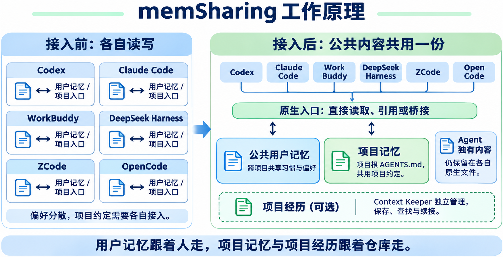

# Memory Sharing & Fusion · 多 Agent 记忆共享与融合

**Multi-Agent Memory Sharing & Fusion**

给你的每一个 AI Agent 同一份记忆。

Give every AI Agent the same memory.

Codex 记住的偏好，Claude 接着用；昨天做到一半的工作，今天任何 Agent 接着做。

Let Claude use the preferences you shared with Codex, and let any Agent pick up yesterday’s work.

## 🧩 记忆分散了，也能整理到一起

Bring scattered memory together

你可能已经在 Codex、Claude 或其他 Agent 里积累了不少习惯和约定。memSharing 的“融合”，就是帮你梳理这些已有记忆：先只读对比，按“默认共享”与“由你选择是否共享”两块展示，每条都能查看完整原文和来源。明确选择后即执行：将选中内容完整迁入公共记忆，核验公共内容与读取入口后，再精确删除来源文件里对应的重复片段，并保留可审计的修改清单和备份。未选、各 Agent 独有或拿不准归属的内容留在原处；查看原文和“保留现状，暂不融合”不修改记忆内容。执行前若发现内容或范围发生实质变化，会停止并说明差异。

You may already have preferences and rules saved in Codex, Claude or other Agents. Memory fusion means reviewing that existing knowledge: you get a read-only preview in two groups — shared by default, and yours to choose — each item with its full original text and sources. Your explicit selection starts execution: the selected content moves in full into common memory; after verifying that content and its reading entries, the tool removes the exact matching fragments from source files, keeping an auditable change list and backups. Unselected, Agent-specific or unclear items stay in place. Viewing original text or choosing “Keep things as they are” leaves memory content unchanged. Material changes to the content or scope before execution stop the operation and are reported.

共享，让各家读同一份；融合，让过去分散积累的内容也能接着用。项目经历的保存、查找与续接由可选的 Context Keeper 提供。

Sharing gives your Agents a common source. Fusion brings existing knowledge into that shared workflow. Optional Context Keeper handles saving, finding and resuming work history.

## 🧠 三种记忆，各管一件事

Three kinds of memory

- **用户记忆：你的习惯，换工具不用重说。** 例如“提交信息用中文”，跨项目共用。
  **User memory:** Share preferences across tools and projects, such as “write commit messages in Chinese.”
- **项目记忆：同一个项目，同一套约定。** 以项目的 `AGENTS.md` 为共同来源，减少各写一份、越写越散。
  **Project memory:** Keep project rules in one shared `AGENTS.md`, rather than maintaining separate copies for each tool.
- **项目经历（可选）：做过什么，下一步做什么。** 由 Context Keeper 保存、查找和续接；不装它，前两种记忆照常使用。
  **Work history (optional):** Use Context Keeper to save decisions, find past work and resume progress. Shared preferences and project rules work without it.

## 🧭 在 Paseo 里能做什么？

What you can do in Paseo

在命令中心搜索 **memSharing**，检查接入状态、启用或停用当前项目。接入与项目变更先展示计划，你确认后才执行；融合按你的明确选择直接执行。公共用户记忆流程结束后，可独立选择安装 Context Keeper。停用项目会保留记忆内容和已有经验记录。

Search for **memSharing** in the Command Center to check your setup or enable or disable memory for the current project. Setup and project changes are previewed for confirmation; fusion executes your explicit selection directly. After the shared user memory workflow ends, you can independently choose to install Context Keeper. Disabling a project preserves its memory and work history.

## ⚙️ 使用条件

Requirements

支持 macOS，要求 Paseo 0.13.2 或更高版本，以及已配置好的编程 Agent。已有 Python 3.9+ 和 Git 可直接使用；缺少时会单独询问是否下载专用环境。项目操作支持 Git 主检出目录，暂不支持 linked worktree。Context Keeper 安装后，项目记录库仍按它自己的流程启用。

Supports macOS. Requires Paseo 0.13.2 or later, and a configured coding agent. Existing Python 3.9+ and Git can be reused; missing tools can be downloaded with separate approval. Project actions support Git main checkouts, not linked worktrees. Context Keeper follows its own process to enable project records.

## 🔒 文件和数据

Files and data

插件有本机文件、进程和网络访问权限。它会读取记忆、规则和接入状态；批准后可修改相关入口、程序文件和登记记录，并保留备份。预览也会留下本地操作记录。

The plugin can access files, processes and the network on the selected host. It reads memory, rules and setup status. Approved changes can update rule entries, program files and registration records, with backups. Previews also leave local operation records.

状态和变更计划会在 Paseo 应用与所选 Host 之间传递，计划可能包含现有规则内容。下载依赖或 Context Keeper 会连接 GitHub。插件没有独立的记忆上传服务，但 Agent 读到的记忆可能随对话发送给你选择的模型服务商。

Status and plans pass between Paseo and the selected host; plans may contain existing rules. Downloads contact GitHub. The plugin has no separate memory-upload service, but memory read by an Agent may be sent to your chosen model provider as conversation context or tool results.

完整卸载后，各 Agent 恢复原有的记忆使用方式；公共记忆会完整归还到各自的原生文件，原有独有内容保留，记忆不会丢失。

After a full uninstall, each agent goes back to its original way of using memory; the shared memory is returned in full to each agent's native files, existing agent-specific content stays in place, and nothing is lost.
